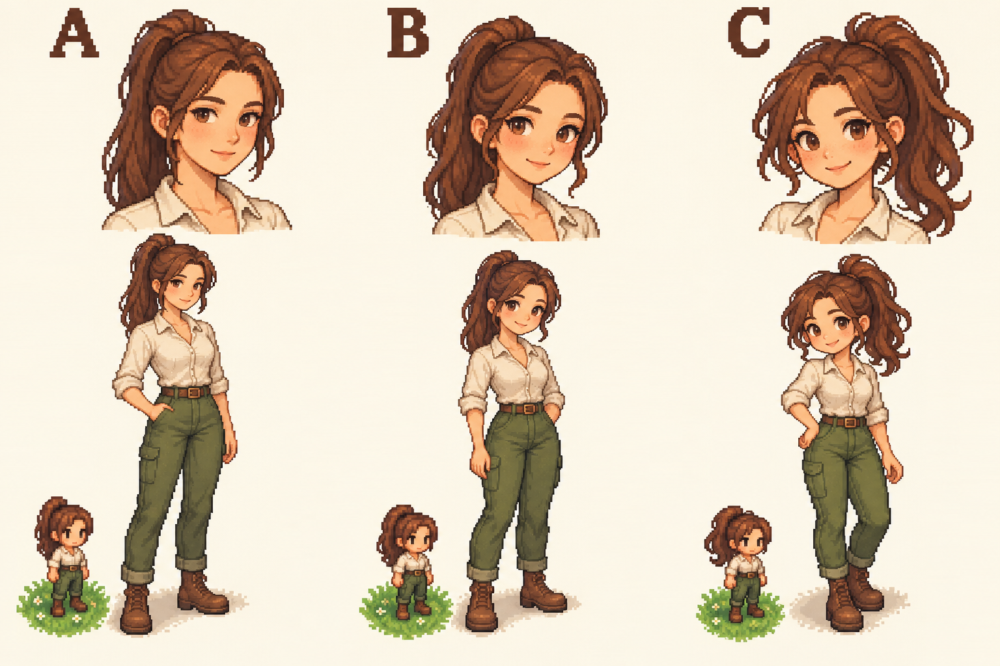

# A főhős karaktertervei – a B változat kiválasztva

- **A:** természetesebb, nyúlánkabb arányok, visszafogottabb arckifejezés.
- **B:** lágyabban stilizált arányok, barátságos, kifejezőbb arc.
- **C:** játékosabb megjelenés, arányaiban nagyobb fej és szemek.

Közös alap: barna, magas lófarok, világos bőr, törtfehér munkásing, mohazöld nadrág, barna bakancs, karcsú alak és jól elkülönülő derék, zárt szájú mosoly.

Saját kérésre generált koncepciók, külső assetcsomag nélkül. Ezek nem elfogadott végleges grafikák vagy beépíthető animációs sprite-ok. A kisméretű figurák a vizuális irányt szemléltetik, nem a játék pontos pixelméretét. Az elfogadott tervből külön, az aktuális játékmérethez és nézőponthoz igazított figura, majd mozgásfázisok szükségesek.

A játékbeli karakter változatlan. A kiválasztásnál az arc, haj és testarányok különböző oszlopokból is kombinálhatók.

**Felhasználói döntés:** a B változat az elfogadott kiindulás. A játékba illő kis méretű figura és az animációk még elkészítendők.
